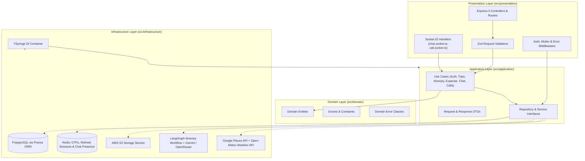
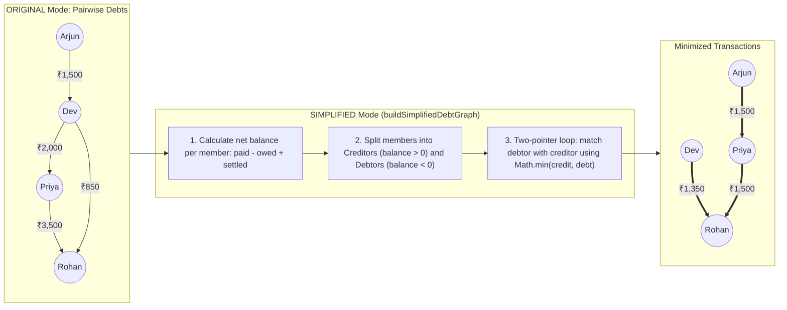
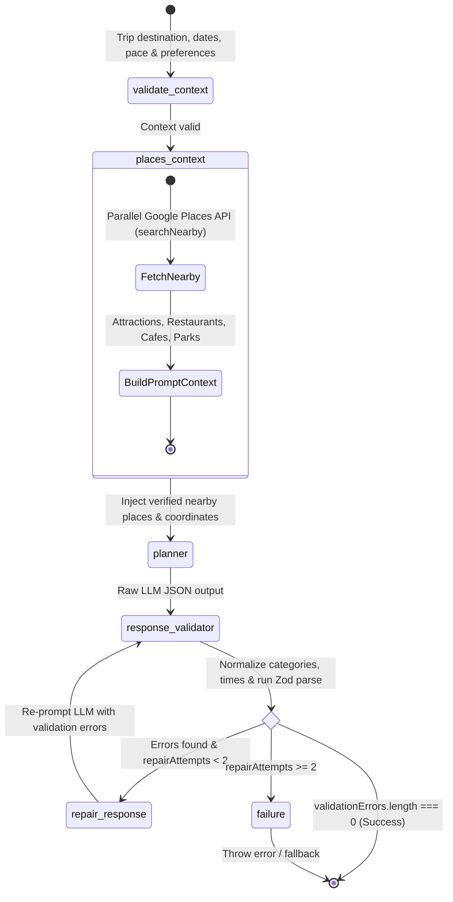
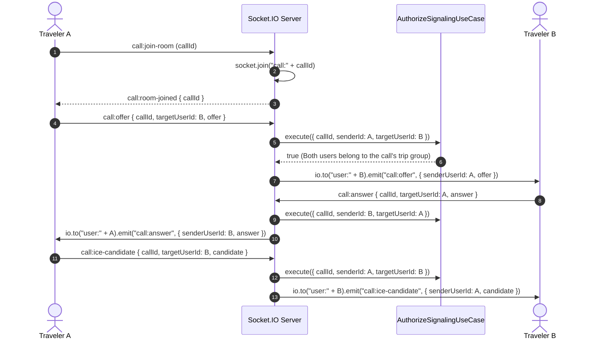
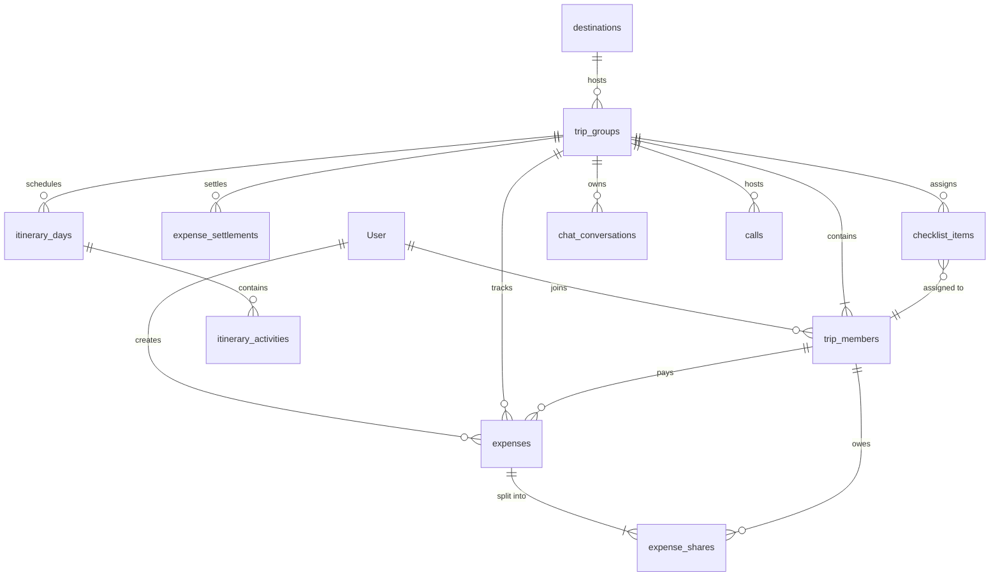
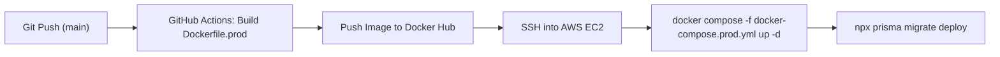

# Kafla Backend (`kafla-server`)

Backend service for **Kafla**, a collaborative group travel planning workspace. Built as a modular monolith using Node.js, Express 5, TypeScript, Clean Architecture, TSyringe (Dependency Injection), PostgreSQL (Prisma ORM), Redis, Socket.IO, and LangGraph.

[](https://www.typescriptlang.org/)
[](https://nodejs.org/)
[](https://www.postgresql.org/)
[](https://www.prisma.io/)
[](https://redis.io/)
[](https://socket.io/)
[](https://langchain-ai.github.io/langgraphjs/)
[](https://www.docker.com/)

---

## 1. Architecture Overview

The backend is structured as a **Clean Architecture modular monolith**. Business rules and use cases are kept separate from Express controllers, Prisma database repositories, and third-party APIs.



### Design Choices
- **Dependency Injection with TSyringe (`src/infrastructure/di`)**: Controllers and use cases depend on TypeScript interfaces (`IExpenseRepository`, `IStorageService`, `IAIModelService`) bound to symbol tokens (`TOKENS`), keeping business logic decoupled from concrete implementations.
- **Layer Separation**:
  - `presentation/`: Express routes, controllers, Zod validators, and middlewares.
  - `application/`: Use cases, DTOs, and repository/service interfaces.
  - `domain/`: Entities, enums, and custom domain errors.
  - `infrastructure/`: Prisma repositories, Redis services, Socket.IO handlers, S3 storage, and the LangGraph itinerary workflow.

---

## 2. Core Implementation Details

### 2.1. Expense Splitting & Debt Simplification (`get-balances.usecase.ts`)

When multiple group members pay for shared expenses across a trip, tracking every individual pairwise debt quickly becomes messy. Kafla supports two balance views (`ORIGINAL` and `SIMPLIFIED`):



- **How `buildSimplifiedDebtGraph` works**:
  1. Sums each member's total `paid`, `owed` (from `expense_shares`), and existing `settlements` to compute their net `balance`.
  2. Filters members with `balance > 0` into a `creditors` list and members with `balance < 0` into a `debtors` list.
  3. Walks through both lists with two pointers (`creditorIndex` and `debtorIndex`), settling `Math.min(creditor.remaining, debtor.remaining)` at each step and advancing whichever pointer reaches `0`. This reduces the total number of payments to at most $N - 1$ in a single $O(N)$ pass over the members.
- **Penny/Paisa Rounding on Equal Splits (`calculateSplit.ts`)**:
  - When splitting an expense evenly (`EQUAL`), `calculateExpenseShares` rounds each share to 2 decimal places and assigns any remaining cent/paisa difference to the last participant (`amount - shareAmount * (participants.length - 1)`) so the shares always add up to the exact total.

---

### 2.2. AI Itinerary Generation with LangGraph (`itinerary.graph.ts`)

Instead of relying on a single LLM prompt that can return broken JSON or made-up places, the AI itinerary generator uses a **LangGraph `StateGraph`** (`src/infrastructure/ai/ai-itinerary/itinerary.graph.ts`) with Google Places enrichment, Zod validation, and a retry/repair loop:



1. **`validate-context` (`validate.node.ts`)**: Verifies required trip parameters before making external API calls.
2. **`places-context` (`place-context.node.ts`)**: Runs 4 parallel Google Places `searchNearby` queries (`Promise.all`) around the destination coordinates for tourist attractions, restaurants, cafes, and parks, passing real place names and coordinates into the prompt.
3. **`planner` (`planner.node.ts`)**: Calls the AI model service (`Gemini` or `OpenRouter`) to generate a structured day-by-day itinerary.
4. **`response-validator` (`response-validator.node.ts`)**:
   - Extracts the JSON object from the model output.
   - Runs `sanitizeItinerary()` to normalize category names (`FOOD`, `TRANSPORT`, `ACCOMMODATION`, `ACTIVITY`, `SIGHTSEEING`, `OTHER`), ensure positive integer durations, and format `startTime` as `HH:mm`.
   - Validates the object against `GeneratedItinerarySchema` (Zod).
5. **`routeValidation` & `repair-response` (`route-validation.ts`, `repair.node.ts`)**:
   - If `validationErrors` is empty, the graph finishes and returns the itinerary.
   - If validation fails and `repairAttempts < 2`, `repairResponseNode` sends the original output and the specific validation errors back to the model at low temperature (`0.2`) to fix the JSON, then re-validates.

---

### 2.3. Real-Time Chat, Redis Presence & WebRTC Signaling

Socket connections (`src/infrastructure/socket/`) authenticate during the handshake via `socket-auth.middleware.ts` by reading and verifying the user's JWT cookie.



- **Multi-Tab User Presence in Redis (`presence.service.ts`)**:
  - When a user connects to `chat.socket.ts`, their `socket.id` is added to a Redis set (`presence:sockets:{userId}`) and their status is marked in a Redis hash (`presence:online`).
  - When a tab disconnects, its `socket.id` is removed from the set. The user is only marked offline (recording a timestamp in `presence:last_seen` and broadcasting `presence:user_offline`) when the set count reaches `0` (all tabs closed).
- **Authorized WebRTC Signaling (`call.socket.ts`)**:
  - Each user joins a personal room (`user:{userId}`) on connect.
  - Before forwarding any `call:offer`, `call:answer`, or `call:ice-candidate` event to `user:{targetUserId}`, `call.socket.ts` runs `IAuthorizeSignalingUseCase` to confirm both the sender and target user are members of the trip group associated with `callId`.

---

### 2.4. Auth, Redis Sessions, OTPs & Media Storage

1. **JWT Cookie & Bearer Authentication (`auth.controller.ts`, `userAuth.middleware.ts`)**:
   - Login and registration issue a short-lived `accessToken` (15m) and a `refreshToken` (7d), both set as `HttpOnly` cookies (`secure: true` and `sameSite: 'none'` in production; `sameSite: 'lax'` in local development).
   - `userAuth.middleware.ts` reads the token from `req.cookies.accessToken` or the `Authorization: Bearer <token>` header (used by the MCP server).
2. **Redis Session Tracking (`session.service.ts`)**:
   - Refresh token hashes are stored in Redis under `session:{userId}:{tokenHash}` with a TTL matching the refresh expiry, allowing sessions to be checked on token refresh and revoked on logout.
3. **Hashed Email OTPs with Attempt Limits (`email-otp.service.ts`)**:
   - Generates a 6-digit OTP, hashes it with `bcrypt`, and stores `{ codeHash, attempts: 0 }` in Redis under `otp:{purpose}:{email}` with a 10-minute expiry.
   - Automatically deletes the OTP and blocks verification after 3 failed attempts.
4. **S3 Media Uploads & Presigned Read URLs (`storage.service.ts`, `upload-chat-image.use-case.ts`)**:
   - Image uploads are parsed with `multer.memoryStorage()`, checked for allowed MIME types (`jpeg`, `png`, `webp`, `gif`) and a 10MB size limit, and uploaded to AWS S3 (`PutObjectCommand`).
   - Private S3 keys are converted to temporary 1-hour presigned URLs (`GetObjectCommand` via `@aws-sdk/s3-request-presigner`) when returning data to the client.

---

## 3. Database Schema (PostgreSQL + Prisma)

The Prisma schema is split into domain model files under `src/infrastructure/database/schema/models/`:



- **Decimal Currency Fields**: Expense amounts, shares, and settlements use `@db.Decimal(12, 2)` in PostgreSQL.
- **Unique Constraints & Indexes**: `expense_shares` enforces `@@unique([expenseId, memberId])`; `trip_members` enforces `@@unique([groupId, userId])`; `itinerary_days` enforces `@@unique([groupId, date])`.

---

## 4. API Overview (`/api/v1`)

### Auth (`/api/v1/auth`)
| Method | Endpoint | Description |
| :--- | :--- | :--- |
| `POST` | `/register` | Register a new user account |
| `POST` | `/login` | Authenticate with email & password |
| `POST` | `/google` | Authenticate with Google OAuth token |
| `POST` | `/send-otp` | Send email OTP for verification or password reset |
| `POST` | `/verify-otp` | Verify 6-digit email OTP |
| `POST` | `/refresh` | Refresh access token using `refreshToken` cookie |
| `POST` | `/logout` | Revoke Redis session and clear auth cookies |

### Trips & Groups (`/api/v1/trips`)
| Method | Endpoint | Description |
| :--- | :--- | :--- |
| `POST` | `/groups` | Create a new trip group |
| `GET` | `/groups` | List active and upcoming trip groups |
| `GET` | `/groups/past` | List past trip groups |
| `GET` | `/groups/:id` | Get trip group details and members |
| `POST` | `/groups/join/:code` | Join a group via invite code |
| `GET` | `/groups/:id/weather` | Fetch daily weather forecast via Open-Meteo API |

### Itinerary (`/api/v1/trips/group/:groupId/itinerary`)
| Method | Endpoint | Description |
| :--- | :--- | :--- |
| `GET` | `/` | Get full multi-day itinerary and activities |
| `POST` | `/ai-generate` | Generate itinerary using the LangGraph workflow |
| `POST` | `/days` | Add a day to the itinerary |
| `POST` | `/activities` | Add an activity to a day |
| `PATCH` | `/activities/:id` | Update an activity |
| `DELETE` | `/activities/:id` | Delete an activity |

### Expenses (`/api/v1/trips/group/:groupId/expenses`)
| Method | Endpoint | Description |
| :--- | :--- | :--- |
| `POST` | `/` | Create an expense (`EQUAL`, `PERCENTAGE`, `CUSTOM`, `SHARES`) |
| `GET` | `/` | List all group expenses |
| `GET` | `/balances` | Get balances (`mode: ORIGINAL` or `SIMPLIFIED`) |
| `POST` | `/settle` | Record a balance settlement between two members |
| `GET` | `/summary` | Get spending summary by category |
| `GET` | `/report` | Get detailed expense breakdown report |

### Checklists (`/api/v1/trips/group/:groupId/checklist`)
| Method | Endpoint | Description |
| :--- | :--- | :--- |
| `GET` | `/` | Get group checklist items and activity log |
| `POST` | `/task` | Create a checklist item |
| `PATCH` | `/task/:taskId` | Update item status or assignee |
| `DELETE` | `/task/:taskId` | Delete a checklist item |

---

## 5. Docker & CI/CD Deployment

The repository includes separate Docker configurations for local development and production deployment on AWS EC2:

- **Local Development (`Dockerfile` & `docker-compose.yml`)**:
  - Runs `node:22-alpine`, `postgres:16-alpine`, and `redis:alpine` with bind-mounted source code (`npm run dev`) and health checks (`pg_isready`).
- **Production (`Dockerfile.prod` & `docker-compose.prod.yml`)**:
  - Uses a two-stage `Dockerfile.prod`: Stage 1 (`builder`) installs dependencies, generates the Prisma client, and compiles TypeScript to `dist/`; Stage 2 (`runner`) installs only production dependencies (`npm install --omit=dev`) and copies `dist/` and Prisma schema/migrations.
- **GitHub Actions CI/CD (`.github/workflows/deploy.yml`)**:
  - On push to `main`, builds the production Docker image, pushes it to Docker Hub, copies `docker-compose.prod.yml` to AWS EC2 over SCP, pulls the new image, restarts the container stack, and runs `npx prisma migrate deploy`.



---

## 6. Local Setup

### Option A: With Docker Compose

```bash
# Start API, PostgreSQL, and Redis
docker compose up --build

# Run in background
docker compose up -d

# View API logs
docker compose logs -f kafla-api
```

### Option B: Manual Setup

```bash
# 1. Install dependencies
npm install

# 2. Generate Prisma Client
npm run db:generate

# 3. Run database migrations
npm run db:migrate

# 4. Start development server
npm run dev
```

### Production Build

```bash
npm run build
npm run start
```
