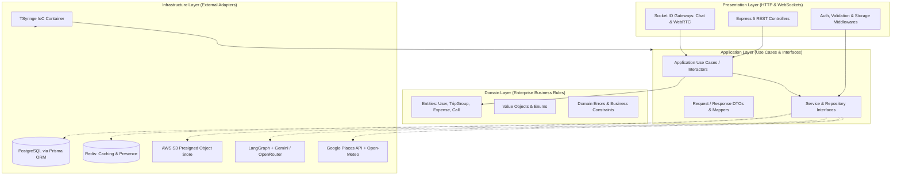
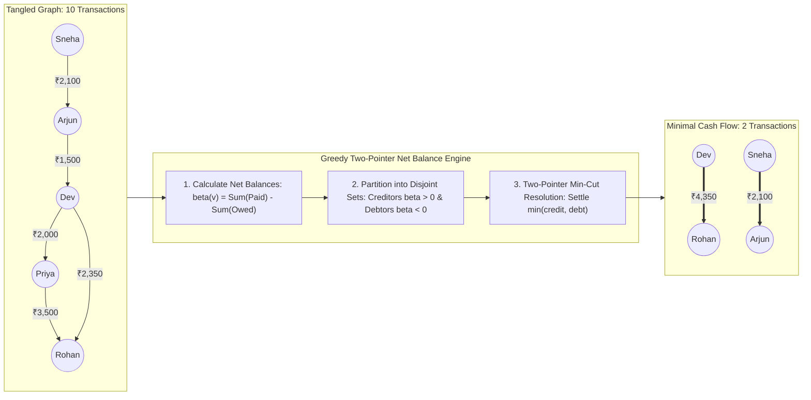
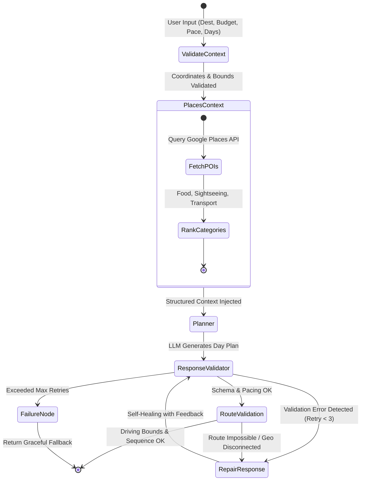
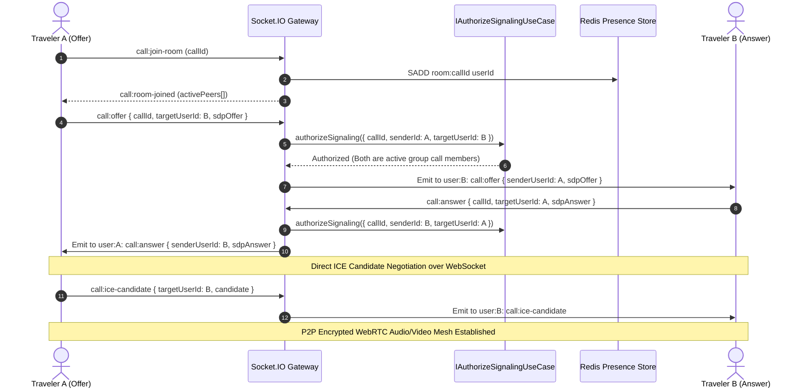
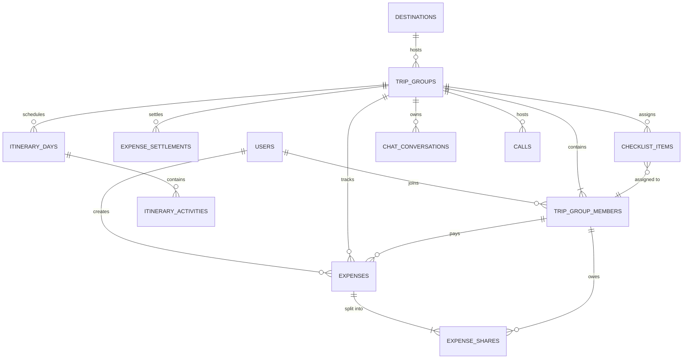

# Kafla Backend Engine (`kafla-server`)

> High-throughput, event-driven collaborative workspace backend powering multi-tenant group expeditions. Architected with Domain-Driven Design (DDD), Clean Architecture, LangGraph stateful multi-agent workflows, WebRTC mesh signaling, and algorithmic cash flow debt minimization.

[](https://www.typescriptlang.org/)
[](https://nodejs.org/)
[](https://www.postgresql.org/)
[](https://www.prisma.io/)
[](https://redis.io/)
[](https://socket.io/)
[](https://langchain-ai.github.io/langgraphjs/)
[](https://www.docker.com/)

---

## 1. System Architecture & Design Philosophy

The Kafla server is built around **Clean Architecture** (Hexagonal / Ports-and-Adapters) and **Domain-Driven Design (DDD)**. The system isolates pure business logic from third-party frameworks, databases, and network transports. 

All dependencies flow inwards toward the Domain:



### Architectural Principles Implemented
- **Inversion of Control (IoC) with TSyringe**: Every repository, use case, and external service is resolved via explicit dependency tokens. Zero hardcoded singletons or tight coupling between business logic and database drivers.
- **Strict Separation of Concerns**: Controllers only handle HTTP status codes and serialization. Use cases execute transactional orchestrations. Repositories handle database persistence.
- **Stateless Application Servers**: All ephemeral state (user presence, active room rosters) is stored in Redis, allowing horizontal scaling behind reverse proxies without session stickiness issues.
- **Event-Driven Asynchronous Pipeline**: Multi-peer WebRTC signaling and real-time chat operate over a decoupled WebSocket gateway with JWT authorization checks at the handshake and frame levels.

---

## 2. Core Engineering Deep Dives

### 2.1. Algorithmic Cash Flow Debt Minimization (Two-Pointer Greedy Net Settlement)

In standard group travel, $n$ members generate an $O(n^2)$ dense directed graph of tangled debts. For example, 5 travelers with 15 cross-shared expenses often result in 10+ confusing mutual payments.

Kafla implements a **Greedy Cash Flow Minimization Algorithm** (`get-balances.usecase.ts`) that transforms the multi-payer debt graph into a net flow network, reducing settlements to at most $V - 1$ transactions:



#### Mathematical Formulation & Time Complexity
1. **Net Balance Vector**: For each member $v \in V$:
   $$\beta(v) = \sum_{e \in E_{\text{in}}(v)} \text{amount}(e) - \sum_{e \in E_{\text{out}}(v)} \text{amount}(e)$$
2. **Partitioning**: Disjoint subsets $C = \{v \in V \mid \beta(v) > 0\}$ and $D = \{v \in V \mid \beta(v) < 0\}$.
3. **Two-Pointer Convergence**:
   $$\text{settled} = \min(\text{remaining}(C_i), |\text{remaining}(D_j)|)$$
   Runs in $O(V \log V)$ due to balance sorting/iteration, down from $O(V^2)$ manual transactions.
4. **Dual Modes Supported**: Users can inspect the un-simplified pairwise multigraph (`mode: ORIGINAL`) or the optimized net settlement graph (`mode: SIMPLIFIED`).

---

### 2.2. Agentic Self-Healing Itinerary Engine (LangGraph StateGraph)

Rather than naive, fragile single-prompt LLM completions, Kafla executes a deterministic, self-healing **StateGraph** built with `@langchain/langgraph` (`itinerary.graph.ts`).

The agent features contextual RAG geo-enrichment, JSON schema enforcement, pacing validation, and an autonomous repair loop:



#### Resiliency Mechanisms:
- **Geo-Context Injection (`places-context.node.ts`)**: Enriches the LLM prompt with verified GPS coordinates and place IDs from Google Places, eliminating location hallucinations.
- **Pacing Engine**: Computes daily activity durations and travel distances, scoring daily itineraries as *Relaxed*, *Balanced*, or *Packed*.
- **Autonomous Repair Loop (`repair.node.ts`)**: When schema parsing or distance limits fail, the validator formats explicit diagnostic feedback back into the prompt context for targeted self-correction.

---

### 2.3. Multi-Peer WebRTC Signaling Mesh & WebSocket Gateway

Group expeditions require real-time audio/video coordination without third-party meeting links. Kafla operates a dedicated WebRTC signaling gateway with cryptographic authorization:



#### Security & Concurrency Controls
- **Signaling Hijack Prevention**: `IAuthorizeSignalingUseCase` verifies that both the sender and the recipient are verified members of the associated `TripGroup` and active in the call room before forwarding SDP or ICE packets.
- **Heartbeat & Disconnect Resilience**: Socket disconnects automatically trigger peer cleanup, update the Redis presence roster, and notify remaining callers.

---

### 2.4. Inversion of Control (IoC) & Dependency Injection

The application uses `tsyringe` to decouple components. Concrete implementations are bound to unique Symbol tokens:

```typescript
// Example: src/infrastructure/di/expense/dependency.ts
container.register<IExpenseRepository>(TOKENS.IExpenseRepository, {
  useClass: ExpenseRepository,
});

container.register<IGetExpenseBalances>(TOKENS.IGetExpenseBalances, {
  useClass: GetExpenseBalances,
});
```

Controllers and use cases inject abstractions, enabling zero-friction unit testing via mock repositories:

```typescript
@injectable()
export class GetExpenseBalances implements IGetExpenseBalances {
  constructor(
    @inject(TOKENS.IExpenseRepository)
    private readonly _expenseRepository: IExpenseRepository,
    @inject(TOKENS.IStorageService)
    private readonly _storageService: IStorageService,
  ) {}
  // ...
}
```

---

## 3. Relational Data Modeling (PostgreSQL + Prisma)

The database schema is partitioned across 7 modular domain schemas:



### Key Schema Optimizations:
- **Financial Precision**: All monetary values (`amount`, `shares`) use PostgreSQL `@db.Decimal(12, 2)` to eliminate floating-point rounding errors.
- **Geographic Indexing**: `destinations` table indexed on `placeId`, `countryCode`, and `state`.
- **Composite Uniqueness**: `expense_shares` enforces `@@unique([expenseId, memberId])`, ensuring no member can be billed twice for the same split.
- **Partitioned Temporal Queries**: Itinerary activities and expenses indexed by `expenseDate` and `dayIndex` for fast range scans.

---

## 4. API Endpoints Overview

The server exposes a structured RESTful API under `/api/v1`:

### Authentication & User Identity (`/api/v1/auth`)
| Method | Endpoint | Description | Auth |
| :--- | :--- | :--- | :--- |
| `POST` | `/register` | Create user with email and credentials | Public |
| `POST` | `/login` | Authenticate with email/password; issues JWTs | Public |
| `POST` | `/google` | Google OAuth2 ID token verification | Public |
| `POST` | `/send-otp` | Request email OTP for verification / password reset | Public |
| `POST` | `/verify-otp` | Verify OTP token | Public |
| `POST` | `/refresh` | Rotate access token via HttpOnly refresh cookie | Refresh Cookie |
| `POST` | `/logout` | Revoke session and clear cookies | Protected |

### Trip Squad Workspace (`/api/v1/trips`)
| Method | Endpoint | Description | Auth |
| :--- | :--- | :--- | :--- |
| `POST` | `/groups` | Create an expedition workspace group | JWT |
| `GET` | `/groups` | Fetch active and upcoming groups for current user | JWT |
| `GET` | `/groups/past` | Fetch concluded / read-only groups | JWT |
| `GET` | `/groups/:id` | Get complete trip group details and active members | JWT |
| `POST` | `/groups/join/:code` | Join squad via 6-character code or invite link | JWT |
| `PATCH` | `/groups/:id/members/role` | Promote/demote members (Owner vs Member) | Group Admin |

### Day-by-Day Itinerary Engine (`/api/v1/trips/group/:groupId/itinerary`)
| Method | Endpoint | Description | Auth |
| :--- | :--- | :--- | :--- |
| `GET` | `/` | Fetch multi-day itinerary with activities and routes | JWT |
| `POST` | `/ai-generate` | Execute LangGraph agentic itinerary workflow | JWT |
| `POST` | `/days` | Manually add a travel day | JWT |
| `POST` | `/activities` | Add an activity with GPS coordinates & time | JWT |
| `PATCH` | `/activities/:id` | Update timing, cost, notes, or location | JWT |
| `DELETE` | `/activities/:id` | Remove activity and recalculate pacing | JWT |

### Expense Ledger & Debt Minimizer (`/api/v1/trips/group/:groupId/expenses`)
| Method | Endpoint | Description | Auth |
| :--- | :--- | :--- | :--- |
| `POST` | `/` | Log an expense with Equal, Exact, or % splits | JWT |
| `GET` | `/` | List all group expenses with shares and payers | JWT |
| `GET` | `/balances` | Fetch net balances (`mode: ORIGINAL` or `SIMPLIFIED`) | JWT |
| `POST` | `/settle` | Record an in-app settlement between members | JWT |
| `GET` | `/summary` | Get category breakdown (Stay, Food, Transport) | JWT |
| `GET` | `/report` | Generate comprehensive financial export summary | JWT |

### Collaborative Checklists (`/api/v1/trips/group/:groupId/checklist`)
| Method | Endpoint | Description | Auth |
| :--- | :--- | :--- | :--- |
| `GET` | `/` | Fetch categorized checklist with member assignees | JWT |
| `POST` | `/task` | Add a packing item with priority (Urgent/High/Med) | JWT |
| `PATCH` | `/task/:taskId` | Toggle completion status | JWT |
| `DELETE` | `/task/:taskId` | Delete task item | JWT |

---

## 5. Security Architecture

1. **Dual-Token Authentication Pipeline**:
   - Short-lived Access Tokens (15 min) delivered in memory/headers.
   - Long-lived Refresh Tokens (7 days) stored in `HttpOnly`, `SameSite: Strict`, `Secure` cookies.
2. **Presigned S3 Object Storage (`storage.service.ts`)**:
   - Images and PDFs uploaded directly from client to AWS S3 via cryptographically signed presigned URLs.
   - **Zero file buffering in Node.js server RAM**, avoiding memory spikes and DoS vectors.
3. **Zod Input Validation**:
   - Every route validates `req.body`, `req.query`, and `req.params` against strict schemas before hitting controllers.
4. **CORS & Rate Protection**:
   - Granular CORS configuration binding WebSocket origins to verified frontend domains.

---

## 6. Local Setup & Development

### Prerequisites
- **Node.js**: `v20.x` or `v22.x` (LTS)
- **PostgreSQL**: `15+` or `16`
- **Redis**: `7.x`
- **Docker & Docker Compose** (Optional, recommended for isolated setup)

### Installation & Database Initialization

```bash
# 1. Install dependencies
npm install

# 2. Generate Prisma Client
npm run db:generate

# 3. Run database migrations
npm run db:migrate

# 4. Start local development server with hot-reload
npm run dev
```

### Running via Docker Compose

```bash
# Spins up PostgreSQL, Redis, and the Kafla Server container
docker compose up --build
```

---

## 7. Verification & Production Build

```bash
# Type check and build TypeScript into dist/
npm run build

# Start production server
npm run start
```

---

## 8. Engineering Highlights for Technical Reviewers

When evaluating this codebase, consider these specific implementations:
- [`get-balances.usecase.ts`](file:///F:/Brocamp/Second%20Project/Kafla/Server/src/application/use-cases/expense/get-balances.usecase.ts): Cash flow graph minimization algorithm reducing $O(V^2)$ debts to $O(V - 1)$ transactions.
- [`itinerary.graph.ts`](file:///F:/Brocamp/Second%20Project/Kafla/Server/src/infrastructure/ai/ai-itinerary/itinerary.graph.ts): Autonomous LangGraph state machine with validation, RAG context enrichment, and self-healing repair loops.
- [`call.socket.ts`](file:///F:/Brocamp/Second%20Project/Kafla/Server/src/infrastructure/socket/call.socket.ts): Authorized WebRTC multi-peer mesh signaling engine.
- [`container.ts`](file:///F:/Brocamp/Second%20Project/Kafla/Server/src/infrastructure/di/container.ts): TSyringe Inversion of Control setup enforcing Clean Architecture.
- [`groups.prisma`](file:///F:/Brocamp/Second%20Project/Kafla/Server/src/infrastructure/database/schema/models/groups.prisma): Modular relational modeling with composite constraints, decimal financial types, and geo-indexing.

---

### Author & License
Crafted by the Kafla Engineering Team. Distributed under the MIT License.
